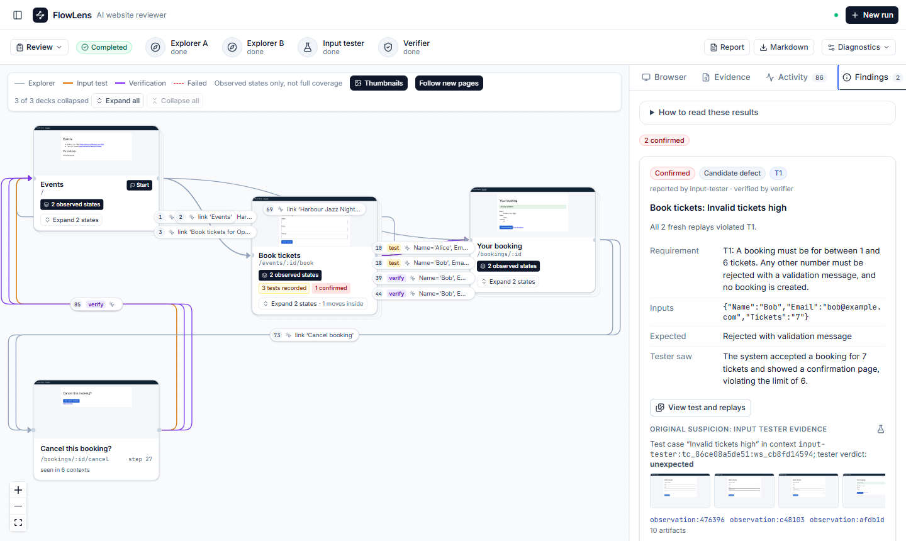

# FlowLens

[](https://github.com/ryanyipp/ai-native-assessment/actions/workflows/ci.yml)

FlowLens is for someone who needs to check a staging website against written requirements, such as a developer or QA reviewer before a release. Model-driven agents click through the site in a real browser, test form inputs against the requirements, and re-check each suspected defect in fresh browser sessions before confirming it. The result is a map of the pages and moves it observed, findings linked to screenshots, and a report.

Scope is deliberately bounded: one user role, Chromium, authorised local or staging origins, and fixed limits on model calls, cost, depth and time. It does not crawl a whole site or repair code, and a finished review does not mean the site passed.

## Demo

**[Demo video (3:44, narrated, MP4)](frontend/public/flowlens-demo.mp4)**: GitHub opens the file page; use **View raw** to download it. The same video plays on the FlowLens landing page at http://localhost:5173.

The video is a recorded run with a real model (Gemini 3 Flash) on Ticket Desk, a fixture app with deliberately seeded defects. With the goal "Test and check the pages and inputs" and four supplied requirements, it confirmed both seeded defects in that build, each in two fresh replays: 7 tickets accepted (T1) and a cancelled booking still listed (T4). The saved run, `run_7bbdcc167bb6`, is bundled and opens without an API key.



## Quick start

Prerequisite: Docker Desktop or Docker Engine with Compose v2.24 or later. The first build downloads about 1–2 GB.

```sh
git clone https://github.com/ryanyipp/ai-native-assessment.git
cd ai-native-assessment
docker compose up --build
```

Open http://localhost:5173. The stack uses host ports 5173 (UI), 8000 (API) and 5174–5179 (three fixture apps, broken and corrected builds).

- **Browse recorded runs (no key, no cost):** choose **Explore recorded demos**. Eight saved runs load at start, including the video's run, and are labelled as recorded results.
- **Live reviews (paid):** copy `.env.example` to `.env`, set `OPENROUTER_API_KEY`, then run `docker compose up --build` again. Choose **Start a review**, pick a target such as `http://localhost:5176/` (Ticket Desk, broken), enter a goal and the requirements, and click **Start live run**. The video's run cost US$0.017; each run is capped at US$0.50 and 60 model calls by default.

`docker compose down -v` removes the containers and the data volume. Native setup without Docker, configuration and the list of recorded runs are in [docs/setup.md](docs/setup.md).

## How it works

| Part | Kind | Role |
|---|---|---|
| Explorer A and B | Model + browser | Choose links and buttons on claimed pages. Code records states, transitions and forms, and refuses repeated actions and form filling. |
| Input tester | Model + browser | Plans input cases for each discovered form. Code fills text fields, dropdowns and tick boxes in a fresh browser and records the outcome; the model judges each case against the requirements. |
| Verifier | Model + browser | Judges whether the requirement applies to the tested control, then picks one typed assertion. Code replays the case in two fresh browsers and evaluates the assertion. |
| Coordinator | Python, no model | Runs the shared task queue: claims with leases, recovery of stalled workers, rejection of late results, and call, cost and time limits. |
| Report | Python, no model | Builds the HTML and Markdown reports from saved records. |

A finding is **confirmed** only when the assertion fails in every replay. It still rests on a model's reading of the requirement and its choice of assertion. Findings that cannot be checked stay visible as inconclusive. Details: [docs/architecture.md](docs/architecture.md).

## Validation and CI

[CI](.github/workflows/ci.yml) runs on every push to `main` and on pull requests, with no secrets:

- **Backend:** Python 3.12 with `uv sync --frozen`, Playwright Chromium, then `pytest`. Tests drive the local fixture apps in a real browser with mocked model clients; the model URL points at a dead port, so no paid call can succeed.
- **Frontend:** Node 22, `npm ci`, `npm run lint` and `npm run build`, which type-checks first.

CI does not run live models, Docker Compose or the browser checks of the UI, and there is no deployment step. Evidence for those is separate: the benchmark records below, saved runs in [submission-evidence/](submission-evidence/), and screenshot-based UI checks (`scripts/ui_check_*.py`). To run the offline checks locally, from the repository root:

```powershell
cd backend; .\.venv\Scripts\python -m pytest -q; cd ..
cd frontend; npm run lint; npm run build; cd ..
```

## Evaluation

The benchmark compares two whole workflows on the Creator Studio and Ticket Desk fixtures (3 seeded defects, 2 repetitions each): the shared queue (two explorers, tester, separate verifier) and a single agent that explores, tests and checks its own findings. It ran on earlier code (fingerprint `d3c871e37e928ad6`), before exploration memory, dropdown and tick-box handling, execution-failure handling and the verifier's applicability check, so it does not measure those.

A detection is **supported** when its assertion fails on the broken build and passes on the corrected build in browser-only replays.

| Six complete models | Shared queue | Single agent |
|---|---|---|
| Supported detections | **18/36** | **13/36** |
| Scored detections | 24/36 | 17/36 |

- **The benefit varied by model.** Supported detections, queue vs single: Gemini 3 Flash 6 vs 3, MiniMax 5 vs 1, GLM 4 vs 4, GPT-5 Nano 1 vs 1, Claude Haiku 1 vs 2, DeepSeek 1 vs 2 (each out of 6).
- **The queue cost 1.2–3.1× more per run.** Gemini queue runs averaged US$0.028.
- **Two batches are combined.** Gemini, Haiku, Nano and DeepSeek come from the rerun batch (called "current-code" after the code of that day); MiniMax and GLM come from a later extension at the same code fingerprint.
- **Qwen and Kimi are incomplete and excluded.** The extension stopped at its spending guard after 45 of 64 runs; their 3–4 runs per cell had no detections and many truncated replies.
- **The sample is small:** 2 repetitions, fixtures also used in development, and no significance test.

Full tables, run IDs and earlier batches: [docs/model-comparison.md](docs/model-comparison.md). Records: [evaluation/results/](evaluation/results/).

## Known limitations

- **Requirements are needed.** Without them, suspicions stay unverified observations.
- **Applicability is a model judgement.** Code checks that it names a tested control, not that it is right.
- **Radio buttons and file inputs are unsupported.** Such cases are marked `execution_failed` before the form is touched. Cases that do not complete get no verdict and do not count as tested.
- **Exploration is bounded and imperfect.** On Leave Desk, explorers still revisit navigation.
- **Recovery works within one process.** If the backend restarts, running reviews are marked `interrupted`, not resumed.
- **Model output can fail.** A truncated or invalid test plan leaves a form untested, and the report says so.
- **Fresh browser contexts do not isolate a public site's server data.** Only the fixtures provide per-run test-data workspaces.

## Documentation and attribution

- [docs/setup.md](docs/setup.md): native setup, configuration, recorded runs, checks.
- [docs/architecture.md](docs/architecture.md): workers, queue, leases and recovery, assertions, current behaviour.
- [docs/model-comparison.md](docs/model-comparison.md): benchmark method and results.
- [docs/development-log.md](docs/development-log.md): build history and problems found along the way.
- [docs/plan.md](docs/plan.md) and [AGENTS.md](AGENTS.md): the agreed plan and the working rules; AGENTS.md lists what was implemented.
- [docs/attribution.md](docs/attribution.md): libraries and AI assistance. The code was written with Claude, as the commit co-author trailers show; Ryan set the scope, ran and recorded the demos, and reviewed the work.
